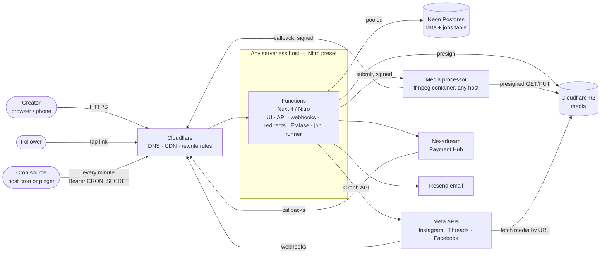
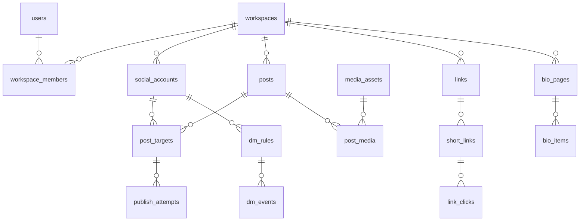
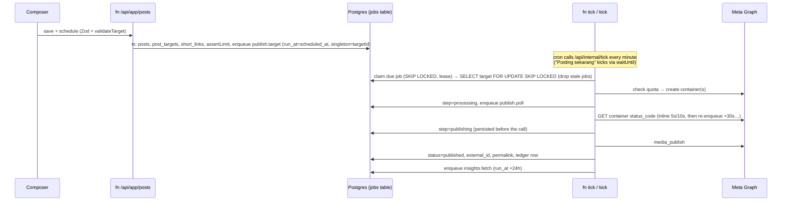
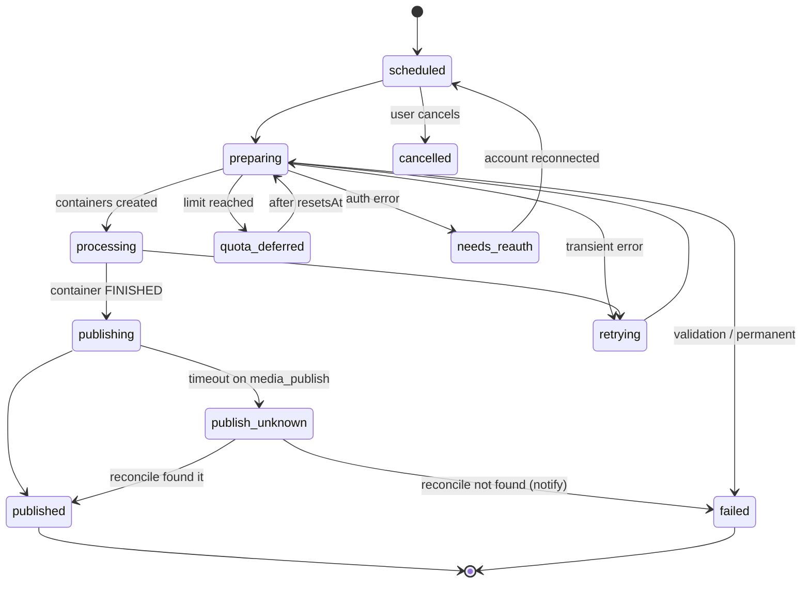
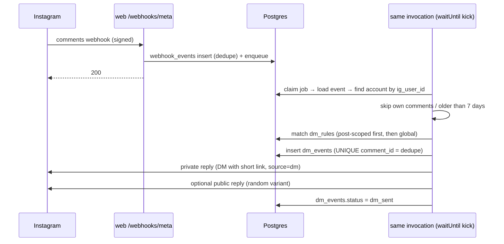

# Architecture — Socialz.id (v1 domain design)

Status: **Approved design, not yet implemented.** Last updated 2026-10-15 (serverless, provider-agnostic refactor; see [`blueprint/19`](blueprint/19-serverless-and-portability.md)).

This document covers the **domain layer** (channels, publishing, short links, Etalase, auto-reply). The **platform layer** (tenancy, auth, RBAC, plans, billing, payments, admin, settings, notifications, API and UI conventions) is specified in [`blueprint/`](blueprint/README.md). Where the two overlap, the blueprint wins for platform concerns.

Related documents:
- [blueprint/](blueprint/README.md): platform layer implementation blueprint
- [PLATFORM-CONSTRAINTS.md](PLATFORM-CONSTRAINTS.md): verified platform API facts and limits
- [ROADMAP.md](ROADMAP.md): milestones and the Meta review critical path
- [SCREENS.md](SCREENS.md): screen list and design brief

---

## 1. Product summary

A multi-tenant SaaS for **Indonesian individual affiliate creators** (Shopee Affiliate, TikTok Shop and others). It has three core features:

1. **Composer + scheduler.** Write a post once, customize it per channel, and publish it automatically to Instagram, Threads and Facebook Pages.
2. **Affiliate links + bio page.** A link vault, tracked short links on our own short domain, click analytics, and a public link-in-bio storefront (the "etalase").
3. **Instagram comment-to-DM.** When someone comments a keyword, the app sends the affiliate link as a private reply DM.

Scope decisions:
- **Customer:** individual creators. v1 has no teams, but a light `workspace` table exists so teams can come later without painful migrations.
- **v1 channels:** Instagram (Business/Creator), Threads, Facebook Pages.
- **Later channels:** TikTok, YouTube, X. Each one plugs in as a new channel adapter (§6).
- **Market:** Indonesia. Prices in IDR. UI in Bahasa Indonesia (default) and English.

### 1.1 Guiding principle: simple enough for a first-time creator

The product is for **anyone starting affiliate marketing**, not only experienced creators or big agencies. A newcomer should be able to sign up, connect Instagram, add a Shopee link and schedule a first post **in under 5 minutes, without reading docs**. Every product and engineering decision is checked against this.

**Product rules**
1. **Guided first run.** Onboarding is a checklist with 4 steps: connect account, create etalase, add first product, schedule first post. Every empty state shows the one next action.
2. **Plain Bahasa, no jargon.** Never show "webhook", "container", "token", "API", "slug", "UTM" or "OAuth" in the UI. Use everyday words: "Jadwalkan" (schedule), "Etalase" (storefront), "Balas Otomatis" (auto reply), "Link Produk" (product link), "Hubungkan Akun" (connect account).
3. **Smart defaults over settings.**
   - Publish to all connected accounts by default.
   - Auto-pick the best post format and suggest a time slot.
   - Timezone is auto-detected (WIB, WITA or WIT).
   - Short links are created automatically.
   - New accounts get a default etalase theme.
4. **One primary action per screen.** Advanced options (per-channel caption, first comment, alt text, link tracking details) stay hidden behind "Opsi lanjutan" until asked for.
5. **The app fixes things for you.** Media is cropped, converted and compressed automatically. Users never see a codec or aspect ratio error unless it truly can't be fixed. Platform limits show as friendly hints before posting, not failures after.
6. **Errors explain the fix.** For example: "Akun Instagram perlu dihubungkan ulang" with a [Hubungkan ulang] button, never a raw error code.
7. **Paste-a-link magic.** Paste a Shopee or TikTok Shop URL and the app fills in title, image and price, creates the short link and offers to add it to the etalase. One paste, three results.
8. **Mobile-first.** Most creators run their business from a phone. Every core flow (compose, schedule, add link, edit etalase) must work one-handed on a phone screen.
9. **Templates over blank pages.** Caption templates ("Review produk", "Promo flash sale", "Unboxing") and ready-made auto-reply rules ("Komentar 'mau' → kirim link").
10. **Free plan is genuinely useful** so newcomers can learn before paying. Upgrade prompts appear only when a limit is actually hit.
11. **Help is in context.** Short tooltips and 30-second video guides in Bahasa, and a WhatsApp support button.

**Engineering rules**
- Prefer **fewer moving parts**: one database, one app (serverless functions on any host), one media container, no microservices, no queue vendor.
- Build the **simplest version that works for v1** and defer optimizations until real usage needs them (see §19).
- Adding a feature for agencies or power users must not add steps to the newcomer flow.

---

## 2. System context



Key points:
- **Functions** serve the UI and API, the OAuth callbacks, the webhooks (store, then process), the short link redirects and the bio pages. **The same functions run background jobs**: a per-minute tick and `waitUntil` kicks execute rows from the `jobs` table (`blueprint/15`). There is no worker process.
- The **media processor** is the only container: ffmpeg transcoding for minutes-long video jobs. It has no database access and no storage credentials (§8.5).
- **Postgres is the only stateful backend.** Neon holds the data, the job queue, schedules and rate-limit counters, so there's no Redis and no queue vendor.
- **Media** lives on R2 behind a public custom domain (`MEDIA_DOMAIN`), because Meta fetches media by public URL.
- **Provider-agnostic:** the host is chosen at build time with a Nitro preset; nothing in the code depends on a specific host (`blueprint/19`).

---

## 3. Deployment topology

| Component | Where | Notes |
|---|---|---|
| Functions | **Any Nitro-supported host**, region pinned to Singapore (near Neon `aws-ap-southeast-1`) | Supported targets and tiers: `blueprint/19` §4. A VPS (`node-server`) is still one valid target |
| Tick | The host's cron (Vercel Cron, EventBridge, Cloud Scheduler, Cron Triggers…) or an external pinger, plus a backup pinger | One entry: every minute → `/api/internal/tick` |
| Media processor | Any container host (Cloud Run, Lambda container, Fly Machines, Azure Container Apps, a VPS) | Scales to zero; concurrency 1 per instance |
| Neon Postgres | `aws-ap-southeast-1`, Launch plan | Pooled URL for all runtime code, direct URL for migrations in CI only, PITR enabled |
| Cloudflare | DNS and proxy for all domains | TLS, DDoS protection, rate limiting rules, the short-domain URL rewrite, `CF-IPCountry` / visitor location headers (no GeoIP database needed) |
| Cloudflare R2 | `MEDIA_DOMAIN` custom domain | Presigned PUT uploads from the browser. Object keys are unguessable |
| Resend | SaaS | Transactional email |
| Nexadream Payment Hub | SaaS (nexadream.id) | Hosted checkout for subscriptions (QRIS, VA, e-wallet, card); no recurring, see `blueprint/08` |

Domains:
- `socialz.id`: the app, API, OAuth callbacks, webhooks and internal job endpoints
- `SHORT_DOMAIN`: `/{slug}` redirects to the affiliate URL; `/@{handle}` serves the bio page
- `MEDIA_DOMAIN`: public media served from R2

Short-domain routing (a Cloudflare URL Rewrite rule, the same for every host; details in `blueprint/19` §7):
```
SHORT_DOMAIN/@{handle}   → /bio/{handle}
SHORT_DOMAIN/{slug}      → /r/{slug}
anything else on SHORT_DOMAIN → 404 (server/middleware/00.host-guard.ts)
```

Release: CI runs lint, types and tests, then `npm run db:migrate` (direct URL, expand / contract), then the seed, then deploys the functions with `NITRO_PRESET=<target> npm run build` (`blueprint/19` §3).

---

## 4. Tech stack

| Concern | Choice | Why |
|---|---|---|
| Runtime | Node 24 LTS (managed by fnm locally, `.nvmrc`) | Nuxt 4.6 requires `^22.22.3 \|\| ^24.15.0 \|\| >=26` |
| Framework | Nuxt 4 (`app/` srcDir) + Nitro server routes | One codebase for SSR pages, API and public bio pages; Nitro presets make it host-agnostic |
| Hosting | Serverless functions on any host (`NITRO_PRESET`) | No lock-in to one provider; see `blueprint/19` |
| UI | Nuxt UI v4 (Tailwind v4) | Full component set, accessible, themeable |
| i18n | `@nuxtjs/i18n`, strategy `prefix_except_default`, default `id` | Bahasa first, English at `/en/...` |
| Auth | better-auth (Drizzle adapter) | Revocable database sessions, email verification, password reset, Google OAuth, built-in rate limit |
| ORM | Drizzle ORM + `drizzle-kit` migrations, driver `pg` (`neon-ws` on tier-2 targets) | Typed SQL, simple migrations, one query API on every runtime |
| Database | Neon Postgres 17 | User choice. Serverless, with branches for staging and PRs |
| Jobs | Own `jobs` table + per-minute HTTP tick + `waitUntil` kicks | Delayed jobs, retries, leases, singleton keys and schedules in Postgres. Works on every host; no worker, no Redis, no queue vendor (`blueprint/15`) |
| Validation | Zod v4 | Shared between client and server |
| Media storage | Cloudflare R2 + `aws4fetch` presign | S3-compatible, no egress fees, small dependency |
| Media processing | ffmpeg / ffprobe in the media processor container (`MediaProcessor` adapter) | Video transcode and image conversion to JPEG; runs on any container host |
| Email | Resend over plain `fetch` | No SDK dependency; credentials in DB settings (`blueprint/10`) |
| Payments | Nexadream Payment Hub (driver contract) | User choice. Hosted checkout, QRIS / VA / e-wallet / card, manual renewal (`blueprint/08`) |
| Tests | Vitest (unit and integration), Playwright (E2E), k6 (redirect load) | |
| Edge | Cloudflare (DNS, proxy, rewrite and rate limiting rules) | Same in front of every host; replaces the reverse proxy |

---

## 5. Repository layout

The full directory layout and layering rules are in [`blueprint/01-architecture.md`](blueprint/01-architecture.md) §3–4. Domain-specific locations:

```
shared/channels/{types,instagram,threads,facebook,registry,validate}.ts   capabilities + validateTarget()
server/core/channels/{adapter,graph-client,instagram,threads,facebook,registry}.ts
server/core/publishing/{state,service,quota}.ts
server/core/media/{service,probe,ffmpeg-args}.ts        (ffmpeg-args + probe shared with the processor)
server/core/services/media/{types,http,local,fake}.ts   MediaProcessor drivers
services/media-processor/{Dockerfile,server.ts,transcode.ts}
server/core/links/{service,cache,clicks,bot,ua,slug}.ts
server/core/bio/service.ts
server/core/autoreply/{rules,matcher,sender}.ts
server/core/net/safe-fetch.ts
server/routes/r/[slug].get.ts                 short link redirect
server/api/webhooks/meta.{get,post}.ts        Meta webhooks
server/api/meta/{data-deletion,deauthorize}.post.ts
server/api/app/channels/[platform]/{connect,callback}.get.ts   social account OAuth
app/pages/bio/[handle].vue                    public Etalase
app/pages/app/{compose,calendar,posts,links,bio,auto-reply,analytics,accounts}/…
server/core/jobs/handlers/{publish,media,dm,token,insights,links,billing,maintenance}.ts
server/api/internal/{tick,jobs/run.post,media/callback.post}.ts
tests/fixtures/{graph,hub}/
```

**Module boundary rule:** `server/core/**` must not use Nitro or Nuxt auto-imports. Everything there is explicit imports and plain functions that take a context object, so request handlers, job handlers, scripts and tests run the same code on every host.

---

## 6. Channel adapter layer

This is the main extension point. Adding TikTok, YouTube or X later means writing one capabilities file and one adapter, then registering both.

### 6.1 Capabilities (shared, pure)

These are pure data, so the composer UI and the server validate a post with the same rules.

```ts
// shared/channels/types.ts
export type Platform = 'instagram' | 'threads' | 'facebook' | 'tiktok' | 'youtube' | 'x'
export type PostFormat = 'feed' | 'carousel' | 'reel' | 'story' | 'text'

export interface MediaRules {
  kinds: ('image' | 'video')[]
  minItems: number
  maxItems: number
  image?: { mimes: string[]; maxBytes: number; aspect?: [min: number, max: number] }
  video?: { codecs: string[]; minSec: number; maxSec: number; maxBytes: number; maxWidth: number }
}

export interface ChannelCapabilities {
  platform: Platform
  formats: PostFormat[]
  maxChars: number
  maxHashtags?: number
  maxLinks?: number
  linkMode: 'clickable' | 'plain' | 'attachment'   // IG = plain (not clickable)
  media: Partial<Record<PostFormat, MediaRules>>
  requiresPublicMediaUrl: boolean
  asyncContainer: boolean                          // IG/Threads: create → poll → publish
  dailyPublishLimit?: number
  supportsFirstComment: boolean
  supportsCommentAutomation: boolean               // IG comment-to-DM
  disclosure?: { brandedContent: boolean }         // TikTok later
  visibilityRestricted?: boolean                   // TikTok pre-audit
}

export interface Issue { level: 'error' | 'warning'; code: string; field?: string; params?: Record<string, unknown> }

export function validateTarget(caps: ChannelCapabilities, draft: TargetDraft, media: MediaMeta[]): Issue[]
```

Issue `code`s are i18n keys, e.g. `channel.instagram.linkNotClickable` (a warning) or `channel.threads.tooManyLinks` (an error).

### 6.2 Adapter (server)

```ts
// server/core/channels/adapter.ts
export interface AdapterCtx {
  account: DecryptedSocialAccount
  fetch: typeof fetch            // injected, so tests can pass a fake
  log: Logger
}

export interface ChannelAdapter {
  caps: ChannelCapabilities
  apiVersion: string             // pinned, e.g. Graph 'v25.0'

  oauth: {
    authorizeUrl(state: string, redirectUri: string): string
    exchange(code: string, redirectUri: string): Promise<ConnectedAccount[]>   // FB can return N Pages
    refresh?(t: TokenBundle): Promise<TokenBundle>
    revoke?(t: TokenBundle): Promise<void>
  }

  getQuota?(c: AdapterCtx): Promise<{ used: number; limit: number; resetsAt: Date }>
  prepare(c: AdapterCtx, t: ResolvedTarget): Promise<{ containerIds: string[] } | { ready: true }>
  checkStatus(c: AdapterCtx, containerIds: string[]): Promise<'pending' | 'ready' | AdapterError>
  publish(c: AdapterCtx, t: ResolvedTarget, containerIds: string[]): Promise<{ externalId: string; permalink?: string }>
  findRecent(c: AdapterCtx, since: Date): Promise<{ externalId: string; caption: string; ts: Date }[]>
  fetchInsights?(c: AdapterCtx, externalIds: string[]): Promise<InsightRow[]>
  sendPrivateReply?(c: AdapterCtx, commentId: string, text: string): Promise<void>
  replyToComment?(c: AdapterCtx, commentId: string, text: string): Promise<void>
  normalizeError(e: unknown): AdapterError
}

export interface AdapterError {
  kind: 'auth' | 'rate_limit' | 'quota' | 'validation' | 'transient' | 'permanent'
  code?: string; subcode?: string; message: string; retryAfter?: Date; fbtraceId?: string
}
```

### 6.3 v1 adapters

| Adapter | OAuth | Publish flow | Extras |
|---|---|---|---|
| `instagram` | Instagram API with Instagram Login (no FB Page needed) | Create container(s) → poll `status_code` → `media_publish`. Carousel = child containers + parent | `content_publishing_limit` for quota, private replies, comment replies, insights |
| `threads` | Threads OAuth (long-lived 60-day token, refreshable) | Create container → poll → `threads_publish`. `link_attachment` on text posts | Insights, replies |
| `facebook` | Facebook Login for Business → Page tokens | `/{page-id}/feed` and `/photos`; Reels via `/{page-id}/video_reels` | `appsecret_proof` on all calls, Page insights |

`graph-client.ts` handles all Graph HTTP calls: the base URL and pinned version, `appsecret_proof`, timeouts, and parsing of `error.code`, `error_subcode` and `fbtrace_id`.

---

## 7. Data model

Conventions:
- IDs are **uuidv7**. Timestamps are `timestamptz`.
- **Tenancy:** every tenant table has `workspace_id NOT NULL`. Child tables use **composite FKs `(workspace_id, parent_id)`**, so a row can't point at another tenant's data.
- All core service functions take `ctx: { userId, workspaceId }`, which `requireWorkspace(event)` resolves.
- No Postgres row-level security in v1. Instead, an integration test checks that every core query filters by workspace.



### 7.1 Identity, tenancy, billing, system
These platform tables are specified in [`blueprint/02-database-schema.md`](blueprint/02-database-schema.md): `users`, `sessions`, `accounts`, `verifications` (creators), `staff_*`, `roles`, `permissions`, `menus`, `workspaces`, `workspace_members`, `workspace_invitations`, `trial_claims`, `plans`, `subscriptions`, `subscription_events`, `payment_gateways`, `payments`, `payment_webhook_events`, `audit_logs`, `notifications`, templates, `app_settings`, CMS tables and `usage_daily`. The domain tables below reference `workspaces.id` as `workspace_id`.

### 7.2 Channels and publishing
| Table | Key columns and constraints |
|---|---|
| `social_accounts` | `platform`, `external_id`, `username`, `avatar_url`, `access_token_enc text`, `refresh_token_enc text` (`enc:v1:…` from `server/core/crypto.ts`; the key version is inside the value), `token_expires_at`, `scopes text[]`, `status` (active / needs_reauth / revoked / disabled), `meta jsonb` (ig_user_id, page_id…). **UNIQUE(platform, external_id) WHERE status <> 'revoked'** (one owner per account, so webhooks route unambiguously). Index(`token_expires_at`) WHERE active |
| `media_assets` | `r2_key`, `public_url`, `mime`, `kind`, `bytes`, `width`, `height`, `duration_ms`, `codec`, `sha256`, `status` (uploading / processing / ready / failed), `processor_ref` (current submission, matched by the callback), `processor_submitted_at`, `variants jsonb`, `error` |
| `posts` | `author_user_id`, `base_caption`, `status` (draft / scheduled / publishing / published / partial / failed / cancelled), `scheduled_at`, `version int` (optimistic lock). Index(`workspace_id`, `scheduled_at`) |
| `post_media` | PK(`post_id`, `position`), `media_id` |
| `post_targets` | `post_id`, `social_account_id`, `platform`, `format`, `caption_override`, `media_override`, `options jsonb` (first_comment, link_attachment, alt_text), `status` (§8.2), `scheduled_at`, `container_ids text[]`, `step`, `external_id`, `permalink`, `attempt_count`, `last_error_code`, `last_error_msg`, `job_id`, `published_at`. Index(`status`, `scheduled_at`), Index(`social_account_id`, `published_at`) |
| `publish_attempts` | `post_target_id`, `attempt_no`, `step`, `http_status`, `error_code`, `error_subcode`, `fbtrace_id`, `response jsonb` (redacted), `outcome`, `duration_ms` |
| `platform_publish_ledger` | `social_account_id`, `published_at`. Used for the local rolling-24h quota count |
| `insight_snapshots` | `post_target_id`, `captured_at`, `metrics jsonb` |
| `usage_counters` | PK(`workspace_id`, `period_start`, `metric`), `count` |

### 7.3 Links and bio
| Table | Key columns and constraints |
|---|---|
| `links` | Vault. `destination_url`, `merchant` (shopee / tokopedia / tiktok_shop / lazada / other), `title`, `image_url`, `price_idr bigint`, `tags text[]`, `archived` |
| `short_links` | `slug` **UNIQUE** (case-sensitive base62, 6 chars), `domain`, `link_id`, `post_target_id NULL`, `channel NULL`, `source` (vault / post / bio / dm), `active` |
| `link_clicks` | **Range-partitioned by month on `clicked_at`**. `short_link_id`, `workspace_id`, `ip_hash text` (hex), `country`, `region`, `city`, `device`, `os`, `in_app` (ig / threads / fb / none), `referrer_domain`, `is_bot`, `is_unique_day`. BRIN(`clicked_at`), btree(`short_link_id`, `clicked_at`) |
| `link_click_daily` | PK(`day`, `short_link_id`, `channel`, `country`, `device`, `referrer_domain`), `clicks`, `uniques`. Retention per plan is applied at query time |
| `bio_pages` | `handle text` (UNIQUE on `lower(handle)`, no citext extension needed), `title`, `bio`, `avatar_media_id`, `theme jsonb`, `seo jsonb`, `published` |
| `bio_categories` | `bio_page_id`, `name`, `position` |
| `bio_items` | `bio_page_id`, `category_id`, `type` (product / link / header / social), `link_id`, `short_link_id`, `title`, `image_url`, `price_label`, `badge`, `pinned`, `position`, `visible` |

### 7.4 Comment-to-DM
| Table | Key columns and constraints |
|---|---|
| `dm_rules` | `social_account_id`, `name`, `scope` (post / global), `external_media_id NULL`, `keywords text[]` (normalized), `match_mode` (exact / contains), `dm_message`, `link_id`, `public_reply_variants text[]`, `daily_cap`, `active`, `paused_reason` (null / plan_limit / kill_switch / account_disabled) |
| `dm_events` | `rule_id`, `social_account_id`, `comment_id`, `commenter_id`, `commenter_username`, `media_id`, `comment_text` (purged after 30 days), `status` (matched / dm_sent / replied / skipped_dup / skipped_expired / rate_limited / failed), `error`. **UNIQUE(social_account_id, comment_id)**; **partial UNIQUE(rule_id, commenter_id) WHERE status = 'dm_sent'** |

### 7.5 Domain system tables
| Table | Key columns and constraints |
|---|---|
| `webhook_events` | Meta webhook inbox. `provider`, `topic`, `dedupe_key`, `payload jsonb`, `received_at`, `processed_at`, `attempts`, `error`. **UNIQUE(provider, dedupe_key)**. Purged after 14 days. (Payment callbacks use `payment_webhook_events`, see `blueprint/08`) |
| `data_deletion_requests` | `platform`, `platform_user_id`, `confirmation_code` UNIQUE, `status` |
| `jobs`, `job_schedules`, `system_heartbeat` | Job queue, platform schedules and tick heartbeat (`blueprint/15` §1.1) |
| `rate_limit_buckets` | Fixed-window counters shared by all instances (`blueprint/16` §4) |

Partitions (later, see §19): once `link_clicks` grows past ~50M rows, a migration switches it to monthly range partitions and the `clicks.partitions` job manages them.

---

## 8. Publishing pipeline

### 8.1 Flow


### 8.2 Target state machine


The parent `posts.status` is derived from its targets: all published means `published`, a mix means `partial`, all failed means `failed`.

### 8.3 Rules
- **The job is only a trigger.** State lives in `post_targets.step`. The handler resumes from the stored step, so retries never repeat a step that already finished.
- **Never blindly retry `media_publish`.** On a timeout or unknown result, go to `publish_unknown` and call `findRecent()`, matching by a caption hash.
- **Rescheduling** cancels the old job row (`status = 'cancelled'` where still `queued`), bumps `posts.version` and enqueues a new job in the same transaction. Stale jobs see a version or time mismatch and exit.
- **An invocation can die mid-step** (time limit, deploy). The job's lease expires and a later tick reclaims it; the handler resumes from `post_targets.step`. If it died after `step = publishing` was stored, the result of `media_publish` is unknown, so the target goes to `publish_unknown` → reconcile, never a second `media_publish`.
- **Quota:** check the local ledger's 24h count before `prepare`. Near the limit, also call the platform quota endpoint. The composer and calendar warn ahead of time when a 24h window would go over.

### 8.4 Jobs (Postgres job table)

Jobs are rows in `jobs`, enqueued in the same transaction as the business write and run by the per-minute tick or an immediate `waitUntil` kick. Mechanics (claiming, leases, budget, fan-out, schedules): [`blueprint/15`](blueprint/15-background-jobs.md).

| Queue | Trigger | Behavior |
|---|---|---|
| `publish.target` | `run_at = scheduled_at`; kick on "Posting sekarang" | Lock, check stale, quota, `prepare` |
| `publish.poll` | Re-enqueue | Inline polls at 5s and 10s, then re-enqueue at +30s, +60s…, max 20 minutes (Reels) |
| `publish.reconcile` | On `publish_unknown` | `findRecent`, match, resolve |
| `media.process` | Kick after upload | Valid JPEG/PNG → `ready` inline; otherwise submit to the media processor (§8.5) |
| `media.watchdog` | `run_at = submit + 35 min` | Lost-callback check; resubmit once, then `failed` |
| `webhook.meta` | Kick after webhook insert | Route by field (`comments`, deauth) |
| `dm.send` | Kick after rule match | Per-account rate cap (Postgres counter). Over the cap: defer with `run_at` |
| `token.refresh` | Schedule hourly | Enqueue `token.refresh.one` (singleton) for tokens expiring within 10 days |
| `insights.fetch` | `run_at` after publish | Post metrics at +24h in v1; account metrics daily |
| `links.unfurl` | Kick after paste | `safe-fetch` the product page, fill title / price / image |
| `billing.daily`, `billing.renewal-reminders`, `engagement.inactivity` | Schedules (WIB) | Platform jobs, specified in `blueprint/15-background-jobs.md` |
| `email.send` | On demand | Resend |
| `maintenance.purge` | Schedule daily | Old webhook events, finished jobs, comment text, expired sessions, rate-limit buckets |

**Error routing** (based on `AdapterError.kind`):
- `transient`: requeue with exponential backoff (`maxAttempts: 5`), then `dead`
- `rate_limit` / `quota`: defer to `retryAfter` and set the target to `quota_deferred`
- `auth`: mark the account `needs_reauth`, pause its targets, notify the user
- `validation` / `permanent`: `failed`, with a readable reason

**Crash-safe by design:** any invocation can be killed at any line. Leases, persisted steps and idempotent handlers make a re-run safe. Each tick writes `system_heartbeat('tick')`, and `/healthz` reports it as stale after 3 minutes (or when the oldest due job is older than 5 minutes).

### 8.5 Media processing

1. The browser uploads straight to R2 (presigned PUT), then calls `POST /api/app/media/:id/complete`, which enqueues and kicks `media.process`.
2. `media.process` sniffs the file. A JPEG or PNG that already meets every channel rule becomes `ready` inline (most phone photos). Everything else (HEIC, WebP, video) is submitted to the `MediaProcessor` adapter with a presigned GET for the source and presigned PUTs for each variant; the asset stays `processing` with a new `processor_ref`.
3. The media processor (ffmpeg container) probes, converts images to JPEG (EXIF stripped) and video to H.264/AAC ≤ 1080p `+faststart`, uploads the variants, and calls the signed `/api/internal/media/callback`.
4. The callback applies the result only if `processor_ref` still matches (`WHERE status = 'processing' AND processor_ref = $ref`), and sets `ready` or `failed` with a plain reason ("Video terlalu panjang untuk Reels (maks 15 menit)").
5. `media.watchdog` handles a callback that never arrives.

The composer shows "Sedang menyiapkan video…" while processing; the creator never sees a codec.

---

## 9. Webhooks

### 9.1 Meta
1. `GET /webhooks/meta`: check `hub.verify_token` and echo `hub.challenge` as text/plain.
2. `POST /webhooks/meta`:
   - `readRawBody(event, false)` returns a Buffer.
   - Verify HMAC-SHA256 against `X-Hub-Signature-256` with `timingSafeEqual`. **Instagram-Login webhooks are signed with the Instagram app secret, not the Facebook app secret**, so choose the secret from the payload's `object`.
   - Split the batch into one row per change, with `dedupe_key` like `ig:comment:<comment_id>`.
   - `INSERT … ON CONFLICT DO NOTHING`, and enqueue the `webhook.meta` job **in the same transaction** (a plain insert into `jobs`).
   - Return 200 in milliseconds, then `event.waitUntil(kick(jobIds))` processes it in the same invocation. If the host has no `waitUntil`, the next tick picks it up.

### 9.2 Comment-to-DM


Instagram rules this design enforces: a DM only within 7 days of the comment, **one DM per commenter**, and follow-ups only within 24h after the user replies. Anti-spam measures: a per-account hourly cap, a daily cap per rule, varied public reply text, and a global kill switch (`DM_ENABLED`).

### 9.3 Payment Hub callbacks
Handled by the platform layer: `POST /api/webhooks/payments/nexadream_hub` stores the callback (deduped), then **re-reads the status from the hub** before applying anything. See [`blueprint/08-payment-gateway.md`](blueprint/08-payment-gateway.md).

### 9.4 Meta data deletion and deauthorize
- Parse `signed_request` (base64url, HMAC-SHA256 with the app secret).
- Queue a purge of tokens, DM events and the account.
- Return `{ url, confirmation_code }`. The URL points to `/legal/data-deletion?code=…`.
- Deauthorize revokes the social account.

---

## 10. Short links and bio page

### 10.1 Redirect path (`SHORT_DOMAIN/{slug}`)
1. Look up the slug in a per-instance LRU (about 50k entries, 30s TTL; a cold instance just misses). A miss costs one indexed query on the pooled URL.
2. Return a `302` to the full original destination with `Cache-Control: no-store`. No framing or cloaking.
3. Insert the click row with `event.waitUntil()` after the response is sent. Losing a few clicks when an invocation is killed is acceptable. There is no in-memory buffer (instances are short-lived).
4. Target: under 5ms server time on a warm cache hit; p95 under 20ms at 200 rps measured at the function (k6 against staging, warm). Cold starts are outside this budget; keep the redirect route's bundle small.

Click enrichment:
- **Geo:** Cloudflare headers (`CF-IPCountry`, plus region and city from visitor location headers).
- **Bots:** a UA regex (facebookexternalhit, meta-externalagent, WhatsApp, TelegramBot, Twitterbot, Googlebot, curl, HeadlessChrome). `HEAD` requests and `Sec-Purpose: prefetch` also count as bots. Bots are still redirected, but flagged `is_bot` and left out of stats.
- **In-app browser:** detected from the UA: `Instagram`, `Barcelona` (Threads), `FBAN`/`FBAV`. The referrer is usually empty in these.
- **Privacy:** `ip_hash = sha256(ip ‖ daily_salt)`. The salt rotates daily and is deleted after 2 days, so the app can count unique visitors without storing IPs.

### 10.2 Attribution
When a post is scheduled, vault links in the caption are replaced by **one short link per target** (`post_target_id`, `channel`), so clicks can be attributed to a post and channel. For Instagram, where caption links aren't clickable, the composer suggests the bio link or a DM rule instead.

### 10.3 Destination safety
- Check destinations with Google Web Risk when they're saved.
- **Free plan:** destinations must be on an affiliate-domain allowlist (shopee.co.id, s.shopee.co.id, tokopedia.com, tiktok.com, lazada.co.id…).
- Keep a spare short domain ready in case the main one gets blocklisted.

### 10.4 Bio page (`SHORT_DOMAIN/@handle`)
- SSR rendered, cached briefly, mobile-first.
- Only plain text from users is rendered (no HTML), under a strict CSP.
- Product cards link through `short_links` with `source=bio`, so bio clicks are tracked.
- When the plan lacks `removeBranding`, the page shows a small "dibuat dengan Socialz.id" footer.

---

## 11. Security

| Area | Measure |
|---|---|
| Token storage | AES-256-GCM with `node:crypto`. Format `[ver][iv12][tag16][ciphertext]`, AAD = `accountId\|platform` (stops ciphertext being swapped between rows). Keys in `TOKEN_KEYS="1:<b64>,2:<b64>"` + `TOKEN_KEY_CURRENT`. `scripts/rotate-keys.ts` re-encrypts old versions. Uses the shared `server/core/crypto.ts` helper (`blueprint/16` §3) |
| Sessions | better-auth database sessions, HttpOnly + Secure + SameSite=Lax cookies, revocable |
| CSRF | SameSite=Lax + middleware that rejects mutating `/api/*` requests unless `Origin` or `Sec-Fetch-Site` matches socialz.id |
| OAuth (channels) | Random `state` in a short-lived HttpOnly cookie, PKCE where supported, exact redirect URIs |
| Rate limiting | Postgres fixed-window counters (`rate_limit_buckets`) for auth, API and webhooks + better-auth limiter with database storage + Cloudflare rate limiting rules on SHORT_DOMAIN and webhooks |
| Plan limits | `assertLimit(ctx, metric)` inside the transaction after `SELECT … FOR UPDATE` on the workspace row |
| SSRF | Media is uploaded only through presigned R2 PUTs; the server never fetches user media URLs. Product unfurling uses `safe-fetch`: https only, private, link-local and metadata IPs blocked (v4 and v6), IP pinned, every redirect re-checked (max 3), 5s timeout, 2MB cap |
| Input | Zod on every handler (`readValidatedBody`, `getValidatedQuery`) |
| Meta calls | `appsecret_proof`; webhook signature verification |
| Internal endpoints | `/api/internal/tick` needs `Authorization: Bearer CRON_SECRET`; fan-out and media callbacks are HMAC-signed with a timestamp (±5 min). Unauthenticated callers get 404 |
| Output | Bio pages render text only, under a strict CSP. Security headers come from Nitro `routeRules.headers` (the same on every host) |
| Logging | Token, cookie and auth-header values are redacted. `audit_log` records connect/disconnect, billing and deletion |
| Compliance | UU PDP (hashed IPs, retention limits, deletion flow), PSE registration, published privacy policy and terms |

---

## 12. Billing

Billing is part of the platform layer:
- Plans, limits and features: [`blueprint/06`](blueprint/06-plans-and-entitlements.md).
- Subscription state machine, checkout, grace and downgrade enforcement: [`blueprint/07`](blueprint/07-subscription-lifecycle.md).
- Nexadream Payment Hub driver: [`blueprint/08`](blueprint/08-payment-gateway.md).

Summary:

| Plan | IDR / month | IDR / year | Trial | Social accounts | Scheduled posts / mo | Etalase | Auto-reply rules | DMs / mo | Click history |
|---|---|---|---|---|---|---|---|---|---|
| Gratis | 0 | 0 | — | 2 | 20 | 1 (branded) | 1 | 100 | 30 days |
| Kreator | 49.000 | 490.000 | 14 days (new signups) | 5 | 300 | 1 | 10 | 1.000 | 180 days |
| Pro (seeded inactive at launch) | 99.000 | 990.000 | 14 days | 12 | 1.500 | 3 | Unlimited | 5.000 | 365 days |

- Prices are draft and include PPN; confirm with a tax advisor. Values are data, editable in `/admin/plans`.
- The hub has **no recurring API**, so renewal is a fresh checkout started by the creator, with reminders at H-7, H-3 and H-1. Paying early stacks onto the remaining time.
- A failed or expired charge enters a 3-day grace period only if the paid time has actually run out. After grace, the workspace drops to Gratis; excess accounts, rules and Etalase pages are deactivated, never deleted.

---

## 13. Configuration (environment variables)

The full list is in [`blueprint/01-architecture.md`](blueprint/01-architecture.md) §5. Business configuration (Resend key, Payment Hub credentials, billing rules, kill switches, affiliate allowlist) lives in DB settings (`blueprint/10`). All env variables are parsed and validated by `server/core/env.ts` (zod) on the first request of each instance, and the instance answers 500 with a clear log line if a required one is missing.

---

## 14. Local development

- **Node 24 LTS through fnm** (`.nvmrc`). *Pending setup: `brew install fnm`, plus the shell hook in `~/.zshrc`.*
- `docker/compose.dev.yml`: `postgres:17` + Mailpit (SMTP capture) + the media processor image. Local Postgres is used for speed; Neon branches are for staging and PR previews.
- `npm run dev` (Nuxt) + `npm run tick:dev` (calls the tick every 15 s, like a host cron). `MEDIA_PROCESSOR_DRIVER=local` runs ffmpeg on the dev machine instead of the container.
- **A named `cloudflared` tunnel** gives stable public URLs for OAuth redirects and Meta webhooks.
- **Meta:** developers and testers get roles on the Meta app, and IG/Threads tester invites must be accepted in the app. Development mode needs no review.
- The Payment Hub has no sandbox: test billing end-to-end on staging with a low-price plan (`blueprint/17` Phase 11). A separate dev R2 bucket.
- `ADAPTER_MODE=fake` swaps the channel adapters for in-memory fakes, for UI work and E2E tests.

---

## 15. Testing strategy

| Layer | Tool | Coverage |
|---|---|---|
| Unit | Vitest | `validateTarget`, caption counting, the state machine, crypto, Meta signature checks, hub callback normalization, bot and UA detection, slug generation, plan limits |
| Integration | Vitest + real Postgres | Services with each test rolled back in a transaction; `runDue()` / `runTick()` called directly with a fake clock; adapters with a fake `fetch` and recorded Graph fixtures (error codes 4/17/32/613 rate limit, 190 expired token, 9007 media not ready, 2207xxx); a tenancy-scoping check |
| Chaos | Vitest | Abort a handler right after `media_publish` and let the lease expire, run two ticks concurrently, deliver duplicate webhooks and media callbacks, drop the DB connection mid-job. Expect **zero duplicates and zero lost posts** |
| Portability | CI | Build every tier-1 preset (`node-server`, `aws-lambda`, `vercel`); run the integration suite against the `node-server` build; a lint rule enforces the runtime contract (`blueprint/19` §2) |
| E2E | Playwright | Signup → verify (Mailpit) → connect (fake) → compose → schedule → published; bio render; redirect; hub callback fixtures (status re-read mocked) |
| Load | k6 | Redirect p95 under 20ms at 200 rps |
| Staging smoke | Nightly | Real publishing to dedicated test IG, Threads and FB accounts |

---

## 16. Observability

- Structured JSON logs on stdout (`server/core/log.ts`), with a request ID / job ID on each line; every host captures stdout.
- `/healthz`: database ping, last tick age, oldest due job age, media processor last callback.
- Uptime monitor on socialz.id and SHORT_DOMAIN.
- Error tracking (Sentry or a self-hosted equivalent). Added in M7.
- Admin metrics: publish success rate by platform, job backlog per queue, dead jobs, DM send rate, webhook lag.

---

## 17. Key decisions (ADR summary)

| # | Decision | Alternatives rejected | Reason |
|---|---|---|---|
| 1 | Postgres-only (own `jobs` table), no Redis | BullMQ + Redis; pg-boss | One stateful service; transactional enqueue together with the business write; no long-lived consumer needed |
| 2 | Jobs run by the app's own functions: per-minute HTTP tick + `waitUntil` kicks + leases (2026-10-15) | Always-on pg-boss worker; Upstash QStash; Inngest / Trigger.dev; host queues (Vercel Queues, SQS) | Works on every host with one cron entry; no vendor; keeps transactional enqueue. Supersedes the earlier worker decision |
| 3 | better-auth | nuxt-auth-utils | Revocable DB sessions and a full email/password flow built in |
| 4 | Drizzle + `pg` | Prisma | Lighter, SQL-first, small bundle; swaps to the Neon serverless driver without touching queries |
| 5 | Instagram Login (not FB Login) for IG | FB Login only | Many creators have no FB Page |
| 6 | Own short domain + bio page | Linking marketplaces directly | IG captions have no clickable links; click attribution is the product's edge |
| 7 | Composite tenant FKs, no RLS in v1 | Postgres RLS | Simpler with a pooler; enforced by tests. Revisit when teams arrive |
| 8 | Presigned browser → R2 uploads | Proxying uploads through the server | No SSRF, no function body-size limits, public URLs that Meta can fetch |
| 9 | Serverless and provider-agnostic: Nitro preset chosen at build (2026-10-15) | Single VPS + Docker + Caddy (the original choice); one host's proprietary platform | User choice. No lock-in; a VPS remains a valid `node-server` target. Supersedes the VPS decision |
| 10 | DB-driven publish state machine | Stateless job retries | Prevents duplicate posts on retries and crashes |
| 11 | Nexadream Payment Hub | Midtrans direct | User choice; shared hub driver across products; hosted checkout for every local method. Trade-off: no recurring billing |
| 12 | Platform layer from the SaaS blueprint (`blueprint/`) | Custom platform design | Proven tenancy, billing and admin rules; adapted to this stack |
| 13 | ffmpeg in a separate media processor container behind an adapter, with presigned URLs and a signed callback | ffmpeg in functions; a transcoding SaaS; ffmpeg.wasm in the browser | Native binary and minutes-long jobs don't fit functions; runs on any container host; holds no secrets |
| 14 | Cloudflare in front of every domain (rewrite, rate limiting, TLS, geo) | Caddy on a VPS; host-specific rewrites | The same edge regardless of origin host, so switching hosts is a DNS change |

---

## 18. Extensibility (post-v1)

| Future item | Change needed |
|---|---|
| TikTok | `shared/channels/tiktok.ts` + `server/core/channels/tiktok.ts`. Mandatory creator-info and disclosure UX, `SELF_ONLY` until the audit passes |
| YouTube | Adapter. Quota is 100 uploads/day per GCP project, so plan for the audit or a quota extension |
| X | Adapter. Pay-per-use API, so meter it and charge for it (`usage_counters`) |
| Teams / agencies | `workspace_members.role` already exists; add invites, approvals and multiple workspaces per user |
| Affiliate commission sync | Shopee Affiliate Open API, Involve Asia: new `affiliate_connections` + `commissions` tables and a sync job |
| Inbox (DMs / comments) | Reuse the webhook inbox + adapters; add `conversations` and `messages` |

---

## 19. Simplicity budget: v1 vs later

To keep v1 small and shippable, these parts of the design start in their simplest form. Each row names the trigger for upgrading it.

| Area | v1 (simple) | Upgrade later, when… |
|---|---|---|
| `link_clicks` storage | Plain table + btree(`short_link_id`, `clicked_at`) index | Monthly partitioning once the table passes ~50M rows |
| Click rollups | Query the raw table for dashboards | Add `link_click_daily` + `clicks.rollup` when dashboards get slow |
| Click logging | One insert per click via `waitUntil` after the redirect | Batch through a `jobs`-style staging table, or an analytics store, at sustained high traffic |
| Destination safety | Affiliate-domain allowlist only | Google Web Risk check when non-affiliate links are allowed |
| Token keys | Single encryption key (format already versioned) | Add rotation script and a second key when needed |
| Insights | One fetch at +24h, plus account totals daily | +1h / +72h / +7d snapshots when analytics matter more |
| Rate limiting | better-auth limiter (database storage) + Postgres fixed windows on sensitive routes + Cloudflare rules | Token buckets if abuse appears |
| Plans | Gratis + Kreator public; Pro seeded inactive | Activate Pro in `/admin/plans` when users hit the Kreator limits |
| Billing methods | Nexadream hub one-time checkout (QRIS, VA, e-wallet, card) for monthly/yearly, with renewal reminders | Recurring billing only if a future driver supports mandates (`blueprint/08` §10) |
| Bio themes | 3 preset themes | Custom colors and layouts |
| Observability | JSON logs + `/healthz` + uptime monitor | Sentry and admin metrics |
| Job trigger | One per-minute tick + kicks + fan-out | A managed queue calling `/api/internal/jobs/run`, if volume or sub-minute precision demands it (`blueprint/15` §7) |
| Admin | Back-office per `blueprint/09`, built after the core flows (Phase 12) | — |

Things that are **not** simplified, because cutting them causes real damage: the DB-driven publish state machine (stops duplicate posts), webhook signature checks and dedupe, token encryption, tenant scoping, and the IG one-DM-per-commenter rule.
