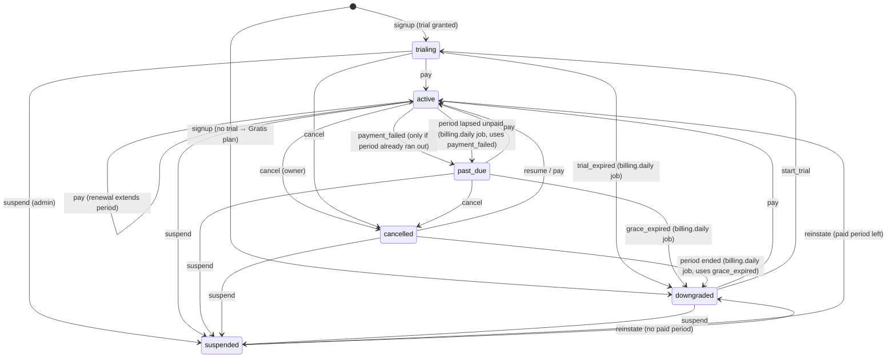
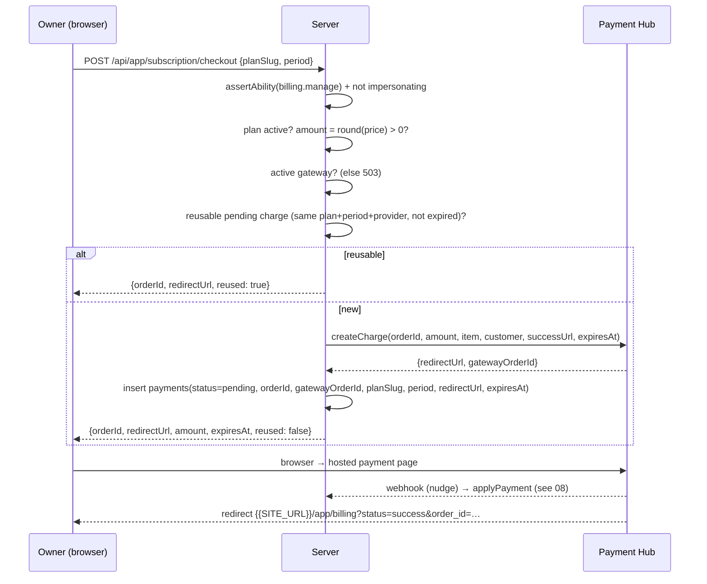

# 07 — Subscription Lifecycle & Billing Flows

## 1. State machine



**`downgraded` means "on the Gratis (default) plan".** It does not mean "no access". A downgraded creator can still schedule posts, keep links and run an Etalase within the Gratis limits.

### 1.1 One writer (MUST)

All transitions go through `transitionSubscription()` in `server/core/subscriptions.ts`. **Nothing else may write `subscriptions.status`.** The only exceptions are signup (which creates the row) and the audited superadmin override. Both of those also write a `subscription_events` row.

```ts
export type SubscriptionTransition =
  | 'start_trial' | 'pay' | 'payment_failed' | 'grace_expired' | 'trial_expired'
  | 'cancel' | 'resume' | 'suspend' | 'reinstate'

const ALLOWED: Record<SubscriptionTransition, SubscriptionStatus[]> = {
  start_trial:    ['downgraded', 'cancelled'],
  pay:            ['trialing', 'active', 'past_due', 'cancelled', 'downgraded'],
  payment_failed: ['active', 'trialing', 'past_due'],
  grace_expired:  ['past_due'],
  trial_expired:  ['trialing'],
  cancel:         ['trialing', 'active', 'past_due'],
  resume:         ['cancelled'],
  suspend:        ['trialing', 'active', 'past_due', 'cancelled', 'downgraded'],
  reinstate:      ['suspended']
}

export interface TransitionInput {
  workspaceId: string
  transition: SubscriptionTransition
  planSlug?: string                 // pay / start_trial
  period?: 'monthly' | 'yearly'
  reason?: string
  force?: boolean                   // skip the ALLOWED guard (system jobs, webhook, admin)
  tx?: DbTransaction                // run inside the caller's Drizzle transaction
}
```

What each transition writes:

| Transition | Writes |
|---|---|
| `start_trial` | plan = `planSlug` or setting `billing.trialPlanSlug` (`kreator`); `status=trialing`; `trialEndsAt = now + plan.trialDays`; clear grace/downgraded/cancelled |
| `pay` | plan = `planSlug` (or current); `period`; `status=active`; `currentPeriodEnd = periodEnd(max(now, currentPeriodEnd), period)` (**renewing early stacks onto the remaining time**); clear grace/trial/cancelled/downgraded |
| `payment_failed` | `status=past_due`; `graceEndsAt = now + billing.gracePeriodDays` |
| `trial_expired`, `grace_expired` | plan = setting `billing.defaultPlanSlug` (`gratis`); `status=downgraded`; `downgradedAt=now`; clear grace/trial/currentPeriodEnd; **then `enforceWorkspaceLimits()`** (outside any transaction) |
| `cancel` | `status=cancelled`; `cancelledAt=now` (keeps `currentPeriodEnd`, so the plan runs to the end) |
| `resume` | `active` if a paid period remains, else `trialing`; clear `cancelledAt` |
| `suspend` | `status=suspended` |
| `reinstate` | `active` if `currentPeriodEnd > now`, else `downgraded` |

After the update, **in the same client** (`tx` if given):

```ts
await db.insert(subscriptionEvents).values({
  workspaceId, transition, fromStatus, toStatus, fromPlanSlug, toPlanSlug, period
})
invalidateEntitlements(workspaceId)
```

- An illegal transition without `force` throws 409 `CONFLICT` `{ from, transition }`.
- A missing subscription or a missing plan throws 404.
- `periodEnd(from, period)` = `addMonths(from, 1 | 12)` in UTC.

### 1.2 Is the subscription actually due?

The Payment Hub has no recurring billing, so a renewal is **a checkout the owner starts by hand**. An owner who opens the payment page two weeks early and abandons it produces an `expired` charge that looks exactly like a genuine default. So a failed or expired charge only enters grace when the paid time has actually run out:

```ts
export function isSubscriptionDue(s: Subscription, now = new Date()): boolean {
  switch (s.status) {
    case 'trialing': return !s.trialEndsAt || s.trialEndsAt <= now
    case 'active':   return !s.currentPeriodEnd || s.currentPeriodEnd <= now
    case 'past_due': return true
    default:         return false
  }
}
```

## 2. Subscription history (`subscription_events`)

The table is append-only. It is written by `transitionSubscription`, by signup (`'signup'`) and by the admin override (`'admin_override'`). The back-office report derives:

- **new paid** = a `pay` whose `fromStatus` is non-paying (`trialing`, `downgraded`, …);
- **renewal** = a `pay` from a paying status;
- **churn** = a move to `downgraded` from a paying status.

**Any new code path that writes `subscriptions` must write an event too**, or it is invisible to revenue reporting.

## 3. Checkout: `startCheckout(ctx, { planSlug, period })` (`server/core/checkout.ts`)

Endpoint: `POST /api/app/subscription/checkout`.



Details:

1. **Gate:** `assertAbility(ctx, 'billing.manage')`, then `assertNotImpersonating(ctx)`. The handler resolved `ctx` with `requireWorkspaceContext(event)`; the impersonation flag travels on `ctx.impersonatorId`.
2. The plan must exist and be `isActive`, else 404.
3. `amount = Math.round(period === 'yearly' ? plan.priceYearly : plan.priceMonthly)`. If `amount <= 0`, throw 400 "Paket ini gratis, tidak perlu pembayaran."
4. `requireActiveGateway(await getActiveGateway())` throws 503 if no gateway is active.
5. **Idempotency: the same plan asked for twice is one charge.** Find a payment with `status ∈ {pending, challenge}`, the same `planSlug`, `period` and `provider`, a non-null `redirectUrl`, and `expiresAt` null or in the future. If one is found, return it with `reused: true`.
6. Otherwise `orderId = generateOrderId()` → `SZ-<Date.now() base36 upper>-<4 random base36 upper>`, and `expiresAt = now + 60 min`.
7. Call `driver.createCharge(creds, { orderId, amount, currency: 'IDR', itemName: 'Socialz.id <Plan> — Bulanan|Tahunan', customer: { name, email, phone }, successUrl: '{{SITE_URL}}/app/billing?status=success&order_id=' + orderId, failureUrl: '…status=failed…', expiresAt, metadata: { workspaceId, planSlug, period } })`.
8. Insert the `payments` row with `gatewayOrderId` from the driver (the id the gateway uses in callbacks), `status: 'pending'` and `raw`.
9. Return `{ orderId, redirectUrl, token?, clientKey?, amount, expiresAt, reused: false }`.

### 3.1 Replacing an unfinished charge: `cancelWorkspacePayment(ctx, paymentId)`

Endpoint: `POST /api/app/subscription/payments/:id/cancel`. This stops one month being paid twice when the owner switches plan mid-checkout.

1. `billing.manage` + not impersonating. The payment must belong to `ctx.workspaceId`, else 404.
2. Status must be `pending` or `challenge`, else 409 "Pembayaran ini sudah diproses."
3. If the provider's credentials still exist, call `driver.cancelCharge(creds, orderId)`, then `applyPayment(result)`. **The gateway decides:** a charge paid seconds ago comes back `paid` and stays paid. The hub answers 409 for a settled charge; surface it to the client, which stops.
4. If the gateway has since been removed, mark the row `cancelled` locally (`rawStatus: 'cancelled_locally'`).
5. Audit `payment.cancel`. Return `{ success, orderId, status: 'cancelled', alreadyCancelled }`.

### 3.2 Client billing page behaviour (`/app/billing`)

- **Data:** `GET /api/app/subscription` returns `{ subscription(+plan), entitlements, plans (active+public), pendingPayments, needsAccountSelection, checkoutAvailable }`. The gateway name and credentials are **never** returned, only `checkoutAvailable`.
- **History:** `GET /api/app/subscription/payments?page&limit` (paged). The pending list above is complete, not paged, because a charge on page 2 is exactly the one that gets paid twice.
- **Layout content:** monthly/yearly toggle; plan cards; current plan with status badge; trial days left; grace notice ("Jika pembayaran belum diterima sampai {tanggal}, paket turun ke Gratis. Data Anda tidak dihapus."); renewal notice when the period ends within `billing.renewalReminderDays` ("Paket Anda berakhir {tanggal}. Perpanjang sekarang agar postingan terjadwal tetap jalan.").
- "Menunggu pembayaran" = status `pending|challenge` **and** not past `expiresAt`.
- **On choose plan:** if unfinished charges exist other than the exact match for this plan+period, confirm "Ganti pembayaran yang belum selesai?", cancel each (stop on the first error), then checkout, then `window.location.href = redirectUrl`. Show the toast "Melanjutkan pembayaran sebelumnya" when `reused`.
- **Return from the gateway** (`?status=…&order_id=…` or `&reference=…`): strip the query (so a reload doesn't repeat it), **read the payment's own status from the API** (the URL is not proof of payment), retry once after ~2.5 s if still pending, then toast accordingly and refresh entitlements.
- Buttons are disabled while impersonating or when `checkoutAvailable` is false.
- **Cancel subscription:** confirm ("Paket tetap aktif sampai akhir periode, lalu turun ke Gratis. Data Anda tidak dihapus.") → `POST /api/app/subscription/cancel`.

## 4. Applying a payment result: `applyPayment(normalized)`

Lives in `server/core/payment-apply.ts`. It is called by the webhook receiver, the admin replay, the reconciler and `cancelWorkspacePayment`. It is idempotent.

```
payment = find by normalized.orderId (OUR order id)            → none: { applied:false, reason:'unknown order' }
payment.status === normalized.status                             → { applied:false, noop:true }
payment.status === 'paid' && normalized.status !== 'refunded'    → noop (terminal)

paymentData = { status, rawStatus, paymentType, paidAt (or now if paid), raw }

status === 'paid':
  db.transaction(tx):                     ← ONE FACT: row paid + subscription activated
    tx.update(payments).set(paymentData)
    transitionSubscription({ workspaceId, transition:'pay', planSlug: payment.planSlug,
                             period: payment.period, force:true, tx })
  then (outside tx): notification 'payment_success' to the owner
       { amount (formatted), planName, periodLabel, orderId, periodEnd, workspaceName, billingUrl }
  → { applied:true }

status ∈ {failed, expired}:
  entersGrace = db.transaction(tx):
    tx.update(payments).set(paymentData)
    sub = select subscription for update
    enters = sub && sub.status ∈ {active, trialing, past_due} && isSubscriptionDue(sub)
    if enters: transitionSubscription({ transition:'payment_failed', force:true, tx })
  if entersGrace: notification 'payment_failed' { amount, planName, workspaceName, graceEndsAt, billingUrl }
  → { applied:true }

otherwise (pending, challenge, cancelled, refunded):
  update(payments).set(paymentData) → { applied:true }
```

**Why one transaction for `paid`:** if the row became `paid` and the subscription activation then failed (for example because a plan slug was renamed), every recovery path would see "already paid" and do nothing. The creator would be charged and left on no plan. Rolling both back keeps the row `pending`, so the next webhook retry, the reconciler or a replay completes it. **Notifications stay outside** the transaction: an email must never roll back a payment, and a transaction must never be held open across the network.

Only the workspace owner is notified of a successful payment. The back-office record is `/admin/payments`.

## 5. Cancel subscription: `cancelSubscription(ctx)`

Endpoint: `POST /api/app/subscription/cancel`.

1. `billing.manage` + not impersonating.
2. If the subscription has a gateway mandate (`providerRef`) and the driver supports it, call `driver.cancelSubscription`. A failure is logged and never blocks the local transition. (The Nexadream hub has no mandates, so this is a no-op today.)
3. `transitionSubscription({ transition: 'cancel' })`. The plan runs to `currentPeriodEnd`, and the billing.daily job then downgrades it.
4. Audit `subscription.downgrade` `{ cancelledBy: 'owner' }`.

## 6. Downgrade enforcement: `enforceWorkspaceLimits(workspaceId)`

This replaces the generic blueprint's branch-limit enforcement. It is called after `trial_expired` / `grace_expired` and after an admin override.

1. Read the effective plan's limits: `socialAccounts`, `autoReplyRules`, `bioPages`. Unlimited (`-1`) means nothing to do for that key.
2. **Social accounts:** active `social_accounts` ordered `createdAt asc`. Keep the first `max`; the rest become `disabled`.
3. **Auto-reply rules:** active `dm_rules` ordered `createdAt asc` (rules on disabled accounts count as paused first). Keep the first `max`; pause the rest (`active=false`).
4. **Etalase pages:** published `bio_pages` ordered `createdAt asc`. Keep the first `max`; unpublish the rest.
5. **Scheduled posts:** `post_targets` in `scheduled` status on a disabled account go back to `draft`, and their queued job rows are cancelled in the same transaction.
6. Steps 2–5 run in **one transaction**, which also sets `workspaces.downgradeResolvedAt = null`. The flag that triggers the "choose" dialog must land with the deactivation it asks about.
7. After commit: notify the owner with `subscription_downgraded` (bell + email), `accountSelectionUrl = {{SITE_URL}}/app/accounts`.

Nothing is deleted. Disabled accounts keep their tokens until the token expires naturally, paused rules keep their keywords, unpublished Etalase pages keep their products. Everything comes back on upgrade.

`needsAccountSelection(workspaceId)` = `downgradeResolvedAt` is null **and** the total number of social accounts > the limit. It is exposed on the profile and subscription endpoints. The console shows a blocking "Pilih akun yang tetap aktif" dialog on `/app/accounts`.

`selectActiveAccounts(ctx, { socialAccountIds })` (`accounts.manage`):
- count ≤ limit, else 402 `LIMIT_REACHED`;
- every id belongs to `ctx.workspaceId`, else 404;
- one transaction: activate the chosen accounts (status `active` if their token is still valid, otherwise `needs_reauth`), disable the others, set `downgradeResolvedAt = now`;
- `invalidateEntitlements(workspaceId)`.

## 7. Renewal model

The Payment Hub has **no recurring API**. Therefore:

- A renewal is **a fresh checkout** the owner starts from `/app/billing`. `pay` extends from the later of now and the current period end, so paying early never loses days.
- The `billing.renewal-reminders` job (07:00 WIB, see `15`) sends `renewal_reminder` to owners whose `active` subscription ends in exactly one of the days listed in `billing.renewalReminderDays` (default `7,3,1`), at most once per day per workspace.
- **An unpaid period lapses into grace.** Because nothing charges automatically, an `active` subscription whose `currentPeriodEnd` has passed with no paid payment extending it is moved by the `billing.daily` job through `transitionSubscription({ transition: 'payment_failed', force: true })`: `past_due` with `graceEndsAt = now + billing.gracePeriodDays`, plus the `payment_failed` notification (sent only because `graceEndsAt` has a value). When grace ends, `grace_expired` drops the workspace to Gratis and runs `enforceWorkspaceLimits()`. The entitlements check keeps `active` granting the plan until that job runs (at most one day), so a creator is never cut off mid-day.
- `createSubscription` in the hub driver throws 501, and `cancelSubscription` is a no-op. Do not build a saved-card flow in the platform.
- If a future driver supports mandates, store `providerRef` + `provider` on `subscriptions`. The cancel path already calls it.

## 8. Notifications fired by billing

| Event | Template key | Channels |
|---|---|---|
| Signup with trial | `trial_started` | bell |
| Trial ends within `billing.trialReminderDays` | `trial_ending_soon` (once per day) | bell + email |
| Paid period ends in 7 / 3 / 1 days (`billing.renewalReminderDays`) | `renewal_reminder` (once per day) | bell + email |
| Payment paid | `payment_success` | bell + email |
| Payment failed/expired while due | `payment_failed` | bell + email |
| Downgrade enforced | `subscription_downgraded` | bell + email |
| Workspace suspended / deleted | `workspace_suspended` / `workspace_deleted` | bell + email |

## 9. Admin views

- `/admin/subscriptions`: list with filters (status, plan, search), trial end, period end and grace end dates.
- `/admin/payments`: every payment, with status, amount, provider, workspace, and order ids (ours and the gateway's), plus the raw status.
- `/admin/workspaces/:id`: subscription card with the **plan override** form (plan, period, status, optional period end, note).
- `/admin/webhook-events`: callback log and replay. See `08-payment-gateway.md`.
